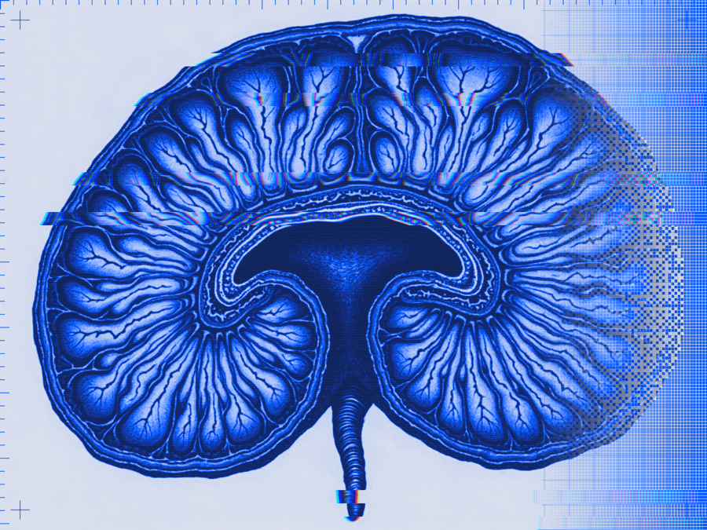
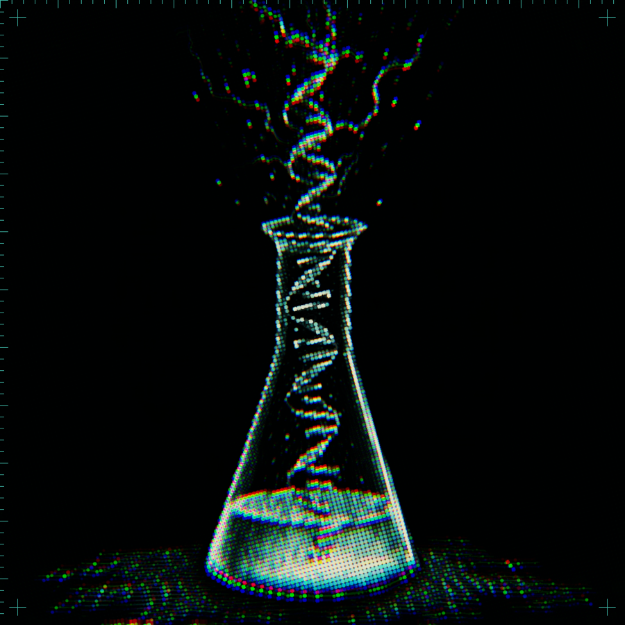
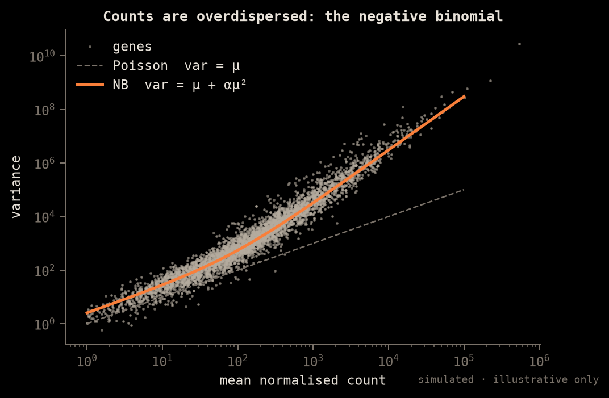
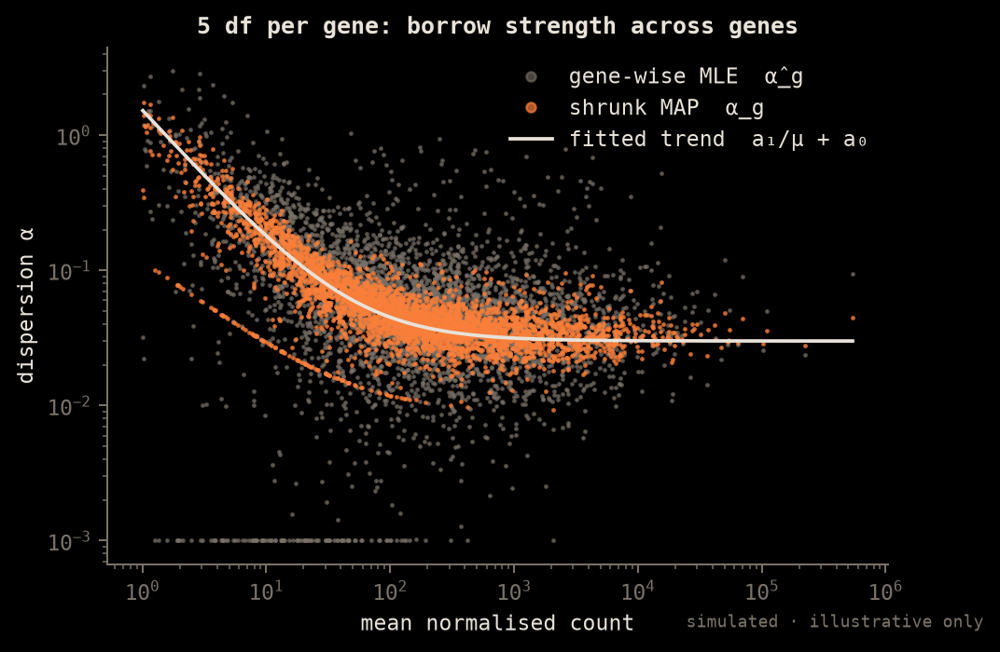
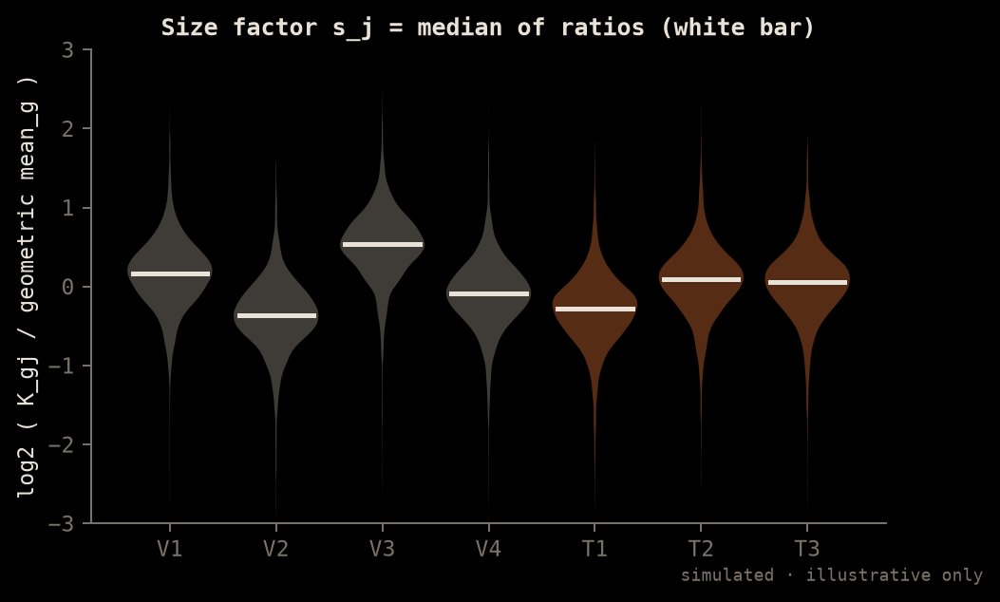
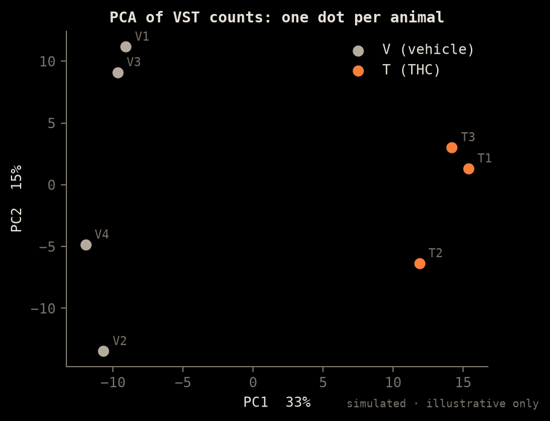
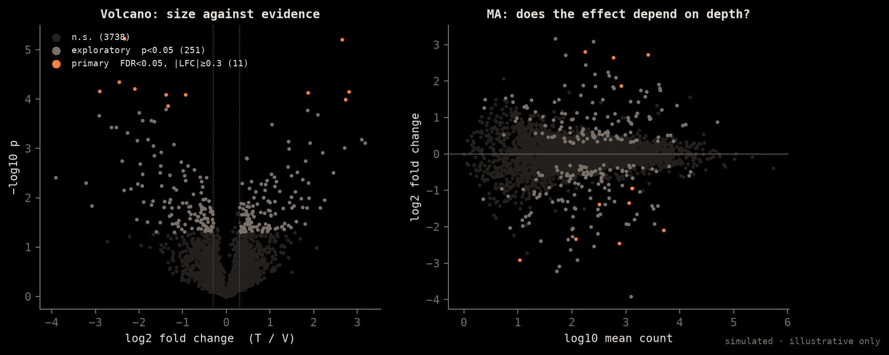
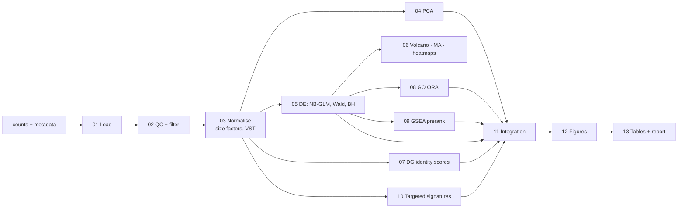

# Bulk RNA-seq (Plethos)

> πλῆθος, the multitude. Each gene gets one number per animal, averaged over every cell in the dentate gyrus.

<p align="center"> </p>

This doc covers what the format is, its degrees of freedom, what people use it for, the tools that process it, the figures that explain it, the maths, and how this repo handles it. Sources: `workflows/bulk-py/` (the Python port), `workflows/bulk-r/` (the R original), `backend/app/omics/workflows.py` and `frontend/src/lib/detect.ts`, all on the `unified` branch.

---

## 1. What the format is

A bulk experiment comes as two tables:

| File | Shape | Content |
|---|---|---|
| **Counts** (`gene_count.xls`, the Novogene matrix, tab-separated) | genes × samples, about 20–55k × n | Non-negative integers: reads assigned to gene *g* in sample *j*. Annotation columns sit next to them (`gene_name`, `gene_chr`, `gene_start/end`, `gene_strand`, `gene_length`, `gene_biotype`, `gene_description`, `tf_family`). |
| **Metadata** (`metadata.csv`) | samples × covariates | `sample`, `group` (here `V` = vehicle, `T` = THC), plus optional `sex`, `batch` and so on. |

Upstream of these tables: FASTQ → aligner or pseudo-aligner (STAR, HISAT2, Salmon, kallisto) → per-gene counter (featureCounts, HTSeq, tximport). Plethos starts at the counts table and never sees reads.

The detector in `detect.ts` calls a dropped table **counts** when the first column looks like a gene ID and more than half of row 2 is numeric. It calls it **metadata** when there are at least 2 columns named like `sample/group/condition/batch/sex`. It calls it **signatures** when the filename is `DG_cell_type_signatures.csv` or `targeted_axes_signatures.csv`.

> **Interactive:** open [`img/omics/omics-iso.html`](img/omics/omics-iso.html) in a browser for two isometric figures, the bulk counts matrix (press `n` to divide by size factors) and nuclei flowing into pseudobulk towers.

*All charts are simulated to show the method; they are not AdoTHC results. They are regenerated by `img/omics/make_charts.py`. The plates are fal-generated engravings treated with homonin foundry recipes.*

## 2. Degrees of freedom

There are three different senses of the term, and each one matters here.

### 2a. Structural: the axes of the data
```
           sample 1  sample 2  …  sample n        ← n is small (here 8, or 7 after T4 is excluded)
 gene 1    c11       c12          c1n
 gene 2    …
 …                                                ← G is large (about 20k after filtering)
 gene G    cG1                    cGn
```
- **Two axes, genes and samples.** There is no cell axis and no spatial or time axis. Tissue heterogeneity is folded into one number per gene per sample.
- **p ≫ n.** Each gene is a separate small-sample problem, so information has to be **borrowed across genes** (dispersion shrinkage, §5) to make up for having few samples.

### 2b. Statistical: residual df of each gene's model
With design `~ group` (2 levels) and n samples, every gene's GLM has **p = 2** coefficients and **n − p residual df**. For 4 vs 3 that is **5 df per gene**. Each covariate in `COVARS` (`sex`, `batch`) costs one more df. DESeq2's empirical-Bayes prior on dispersion is what makes 5 df usable.





### 2c. Analytic: the choices an analyst makes (the "garden of forking paths")
Every knob below changes the gene list. All of them are exposed in `config.py`/`config.R` and in the workbench Params pane.

| Choice | Default here | Alternatives |
|---|---|---|
| Sample exclusion | `EXCLUDE = ["T4"]`, plus a with/without sensitivity run | keep all; outlier rule |
| Low-count filter | ≥ `FILTER_MIN=10` counts in ≥ `FILTER_FRAC=0.5` of samples | `filterByExpr`, independent filtering only |
| Gene universe | all biotypes (`PROTEIN_CODING_ONLY=False`) | protein-coding only |
| Normalisation | DESeq2 median-of-ratios | TMM (edgeR), upper-quartile, TPM (not for DE) |
| Transform for PCA and heatmaps | VST / rlog | log2(CPM+1) |
| Design | `~ group` | `~ sex + batch + group` |
| Contrast direction | `T` vs `V` (log2FC > 0 means up in THC) | |
| DE thresholds | `FDR=0.05`, `|LFC|≥0.30`; exploratory tier `p<0.05` | LFC shrinkage (apeglm/ashr), `lfcThreshold` tests |
| Enrichment | GO ORA (`GO_QVAL=0.05`) + preranked GSEA (size 10–500, 1000 permutations) | camera, fry, GSVA |
| Gene sets | Hallmark, MSigDB GO-BP, Reactome (cached JSON) | KEGG, custom |
| Signatures | DG cell-type identity + targeted axes | deconvolution (CIBERSORTx, MuSiC) |

## 3. Use cases

- **Whole-tissue condition contrasts**: THC vs vehicle in the dentate gyrus. This is the main use here.
- Pathway-level readouts when the effect sizes on individual genes are small.
- **Cell-composition proxies**: identity scores (stage 07) ask whether an apparent "DE" is really a shift in cell-type mix.
- Biomarker panels, dose and time series, and validation of hits from single-cell or proteomics work.
- Cheap and deep. Bulk detects low-abundance transcripts that single-nucleus data misses, which is why the two workbenches are complementary (§7).

## 4. Tools in current use

| Stage | R / Bioconductor | Python |
|---|---|---|
| Counting | Rsubread featureCounts, tximport | HTSeq, Salmon/kallisto + pytximport |
| DE | **DESeq2**, edgeR, limma-voom | **PyDESeq2** |
| Shrinkage | apeglm, ashr | PyDESeq2 `lfc_shrink` |
| Enrichment | clusterProfiler, **fgsea**, goseq | **gseapy** (prerank, enrichr) |
| Viz | ggplot2, pheatmap/ComplexHeatmap, EnhancedVolcano | matplotlib, seaborn |
| GUI and reporting | iDEP, DEBrowser, Degust, MultiQC | — |

This repo ships **both** the R pipeline (`bulk-r/`, the reference) and a Python port with the same parameter names (`bulk-py/`), so the two can be checked against each other.

## 5. Mathematical formulation

**Model.** For gene *g* and sample *j*:

$$K_{gj} \sim \mathrm{NB}(\mu_{gj},\ \alpha_g), \qquad \mathrm{Var}(K_{gj}) = \mu_{gj} + \alpha_g\,\mu_{gj}^2$$

$$\mu_{gj} = s_j\, q_{gj}, \qquad \log_2 q_{gj} = \sum_r x_{jr}\,\beta_{gr}$$

*s_j* is the size factor, *x* is the design matrix (intercept + `group` [+ covariates]), and β₍g,group₎ is the log2 fold change.

**Size factors (median of ratios).**

$$s_j = \operatorname{median}_{g:\,K_{g\cdot}>0}\ \frac{K_{gj}}{\left(\prod_{v=1}^{n} K_{gv}\right)^{1/n}}$$



**Dispersion shrinkage.** Gene-wise MLEs *α̂_g* are fitted to a trend $\alpha_{\text{tr}}(\bar\mu)=a_1/\bar\mu + a_0$. Each gene's estimate is then pulled toward the trend with a log-normal prior, $\log\alpha_g \sim \mathcal N(\log\alpha_{\text{tr}}(\bar\mu_g),\ \sigma_d^2)$, and the MAP is used. This is the "borrowing across genes" from §2a.

**Test.** Wald test: $z = \hat\beta_g / \mathrm{SE}(\hat\beta_g)$. Cook's distance flags outliers, and those genes are refit (`refit_cooks=True`). The test is two-sided, giving p-values.

**Multiplicity.** Benjamini–Hochberg on the genes that pass independent filtering:

$$p^{\text{adj}}_{(i)} = \min_{k\ge i}\ \min\!\left(1,\ \frac{G'}{k}\,p_{(k)}\right)$$

Primary DEG: $p^{\text{adj}} < 0.05$ **and** $|\hat\beta| \ge 0.30$.

**VST (for PCA and heatmaps only, never for DE).** It approximately removes the mean–variance dependence:

$$\mathrm{vst}(K) \approx \log_2\!\left(\frac{1 + \alpha K + 2\sqrt{\alpha K(1+\alpha K)}}{4\alpha}\right)$$

**PCA.** Done on the top-variance VST genes, centred; $X = U\Sigma V^\top$. Percent variance for PC*k* is $\sigma_k^2/\sum\sigma^2$.

**ORA (hypergeometric).** With N genes in the universe, K of them in the set, n DEGs and k of those in the set:

$$p = \sum_{i\ge k} \frac{\binom{K}{i}\binom{N-K}{n-i}}{\binom{N}{n}}$$

**GSEA.** Rank genes by a statistic $r_g$ (Wald stat or sign·−log p). The enrichment score is

$$ES(S) = \max_i \left| \sum_{g_j \in S,\, j\le i} \frac{|r_{g_j}|}{N_R} - \sum_{g_j\notin S,\, j\le i} \frac{1}{N-N_S} \right|$$

It is normalised against a permutation null (1000 permutations in gseapy), giving NES and FDR.

**Signature scores.** For a gene set S, $\text{score}_j = \frac{1}{|S|}\sum_{g\in S} z_{gj}$, where z is the VST value z-scored per gene. Groups are compared with a t-test or Wilcoxon test with BH across signatures; those results feed the effects (forest) plot.

## 6. Figures that explain and analyse it

| Figure | Answers | Spec kind in the workbench (`kinds.tsx`) |
|---|---|---|
| Library size / detected genes per sample | Did a library fail? | `groups` |
| Count-density histogram before and after filtering | Was the filter sensible? | `histogram` |
| Sample-distance heatmap | Do replicates cluster? | `heatmap` |
| **PCA** (PC1 vs PC2, coloured by group) | Is group the dominant axis? Is T4 an outlier? | `embedding` |
| Dispersion plot (gene-wise, fitted, final vs mean) | Does the NB model fit? | `xy` |
| **Volcano** (log2FC vs −log10 p) | How many hits, which direction, how big? | `de` |
| **MA** (log2FC vs log mean) | Is there intensity-dependent bias? | `de` |
| Top-DEG heatmap (z-scored VST, columns grouped) | Are the hits consistent across animals? | `heatmap` |
| Per-gene dot/box (normalised counts by group) | Is the hit driven by one animal? | `gene` |
| GO / GSEA bar or dot plot (NES, padj, set size) | Which biology moved? | `enrichment` |
| GSEA running-score curve | Where in the ranking does the set sit? | `xy` |
| Gene-set overlap matrix | Are the "different" terms the same genes? | `overlap-matrix` |
| Signature forest plot (estimate ± 95% CI) | Did cell-type identity shift? | `effects` |
| Sensitivity scatter (LFC with T4 vs without) | Does the conclusion depend on one sample? | `xy` |







## 7. How this repo approaches it now

- **The sources are the definition.** `workflows.py` reads stage titles from the `## NN_name.R — summary` banners and parameters from `config.R`/`config.py`. It does not restate the science, so editing a script changes the workbench.
- **Two engines, one parameter set.** The R scripts are the reference and the Python port uses the same names and defaults. The runner (`backend/app/omics/runner.py`, `engines/rscript.py`, `engines/python_scripts.py`) runs whichever engine is selected, stage by stage, and streams logs to the Log pane.
- **Figures are specs, not PNGs.** Stages emit JSON specs (`de`, `embedding`, `heatmap`, …) that `kinds.tsx` draws interactively, with hover tooltips showing log2FC, padj, p and baseMean. `StaticFigure` covers the rest.
- **Pre-registered decisions.** The T4 exclusion is fixed in config and checked by a with/without sensitivity run (`sensitivity.py`), not decided after seeing the results.
- **Two tiers of hits.** A primary tier (FDR + LFC) and an explicitly labelled exploratory tier (nominal p), so weak signals are reported without being overstated.
- **Offline gene sets.** Hallmark, GO-BP and Reactome are cached as JSON under `workflows/signatures/genesets/`.
- **Tests and bench.** `backend/tests/omics/test_plethos.py` and `bench/omics_bench.py`.

**Known gaps:** LFC shrinkage is not in the default output. There is no surrogate-variable or RUV batch correction. Deconvolution is limited to signature scoring. Binary `.xlsx` detection goes by filename only.
