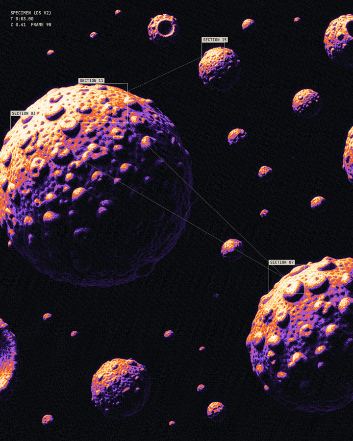
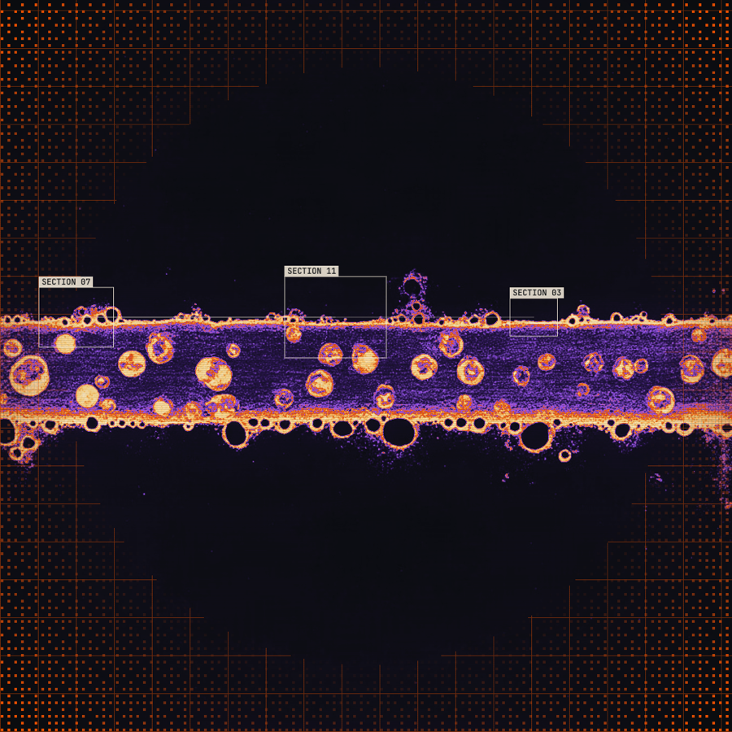
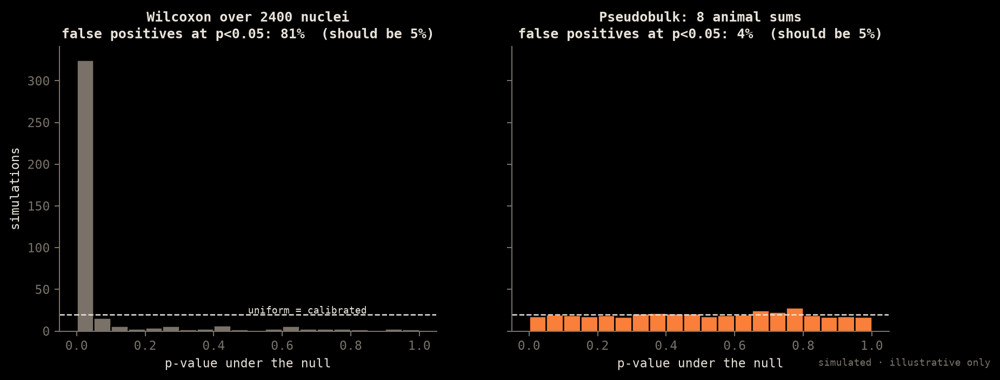
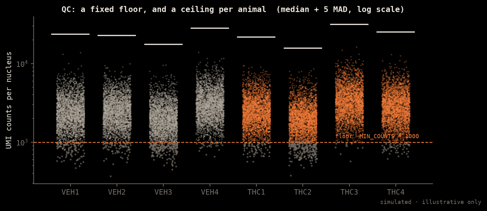
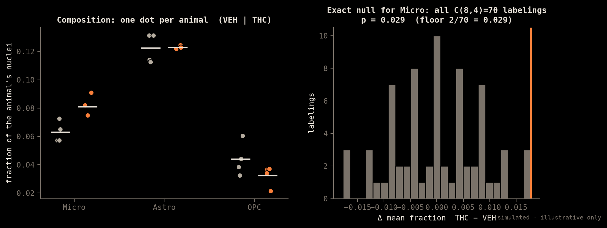
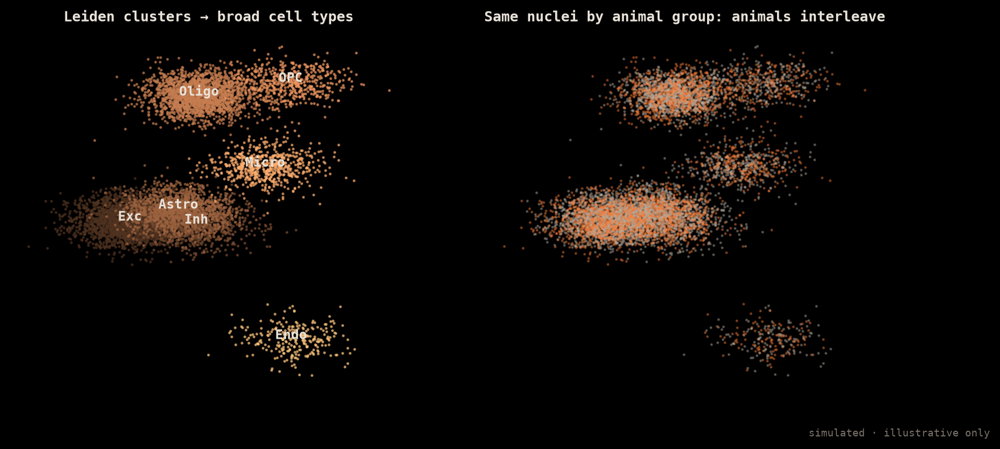
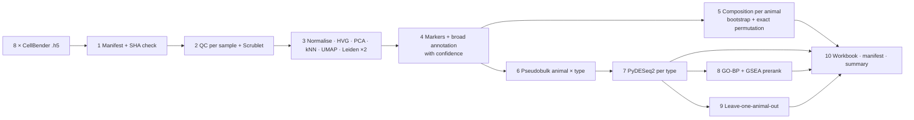

# Single-nucleus RNA-seq (Karyon)

> κάρυον, the kernel or nucleus. Each nucleus gets its own profile, across eight animals.

<p align="center"> </p>

This doc covers what the format is, its degrees of freedom, what people use it for, the tools that process it, the figures that explain it, the maths, and how this repo handles it. Source: `workflows/snrna/AdoTHC_hippocampus_scanpy_AUTOMATED.ipynb` (the notebook's markdown and comments are in Portuguese), driven through `backend/app/omics/engines/notebook.py`, with detection in `frontend/src/lib/detect.ts`.

**The fixed design:** 8 whole hippocampi (4 VEH, 4 THC), one animal per library, tissue not perfused. **The experimental unit for THC vs VEH is the animal, never the nucleus.** Almost every choice below follows from that.

---

## 1. What the format is

| Container | What's inside | Notes |
|---|---|---|
| **10x `.h5`** (CellRanger `filtered_feature_bc_matrix.h5`) | Sparse CSC matrix of barcodes × genes, plus `features` (ID, name, type) and `barcodes` | HDF5 magic `89 48 44 46 0D 0A 1A 0A` |
| **CellBender `*_filtered.h5`** | Same 10x layout, but with **ambient RNA removed** by a generative model | Here this is the required input: `*_lr5e5_filtered.h5`, one per sample |
| **10x MTX triplet** | `matrix.mtx(.gz)`, `features.tsv(.gz)`, `barcodes.tsv(.gz)` | Matrix Market coordinate format |
| **`.h5ad`** (AnnData) | `X`, `layers["counts"]`, `obs` (per-nucleus), `var` (per-gene), `obsm` (PCA/UMAP), `uns` | What the notebook writes as checkpoints |
| `.loom` | HDF5 matrix plus row and column attributes | Accepted by the detector |

Upstream: FASTQ → CellRanger / STARsolo / alevin-fry (barcode + UMI demultiplexing, intronic reads counted, which matters for **nuclei**) → CellBender `remove-background`.

In `detect.ts`, `.h5`/`.h5ad` files must start with the HDF5 signature. That check is how they are told apart from SNIRF, which is also HDF5 but goes to the EEG workbench (Sema).

> **Interactive:** open [`img/omics/omics-iso.html`](img/omics/omics-iso.html) in a browser for two isometric figures, the bulk counts matrix (press `n` to divide by size factors) and nuclei flowing into pseudobulk towers.

*All charts are simulated to show the method; they are not AdoTHC results. They are regenerated by `img/omics/make_charts.py`. The plates are fal-generated engravings treated with homonin foundry recipes.*

## 2. Degrees of freedom

### 2a. Structural: the axes of the data
```
 obs (nuclei)   ~10⁴–10⁵ per animal, ×8 animals      ← nested: nucleus ⊂ animal ⊂ group
 var (genes)    ~30k (GRCm39)
 X              sparse UMI counts, >90% zeros
 + derived axes: HVG subspace (3000) → PCs (40) → kNN graph (k=15) → clusters → cell types
```
- **Three nested levels: nucleus ⊂ animal ⊂ group.** That gives far more axes than bulk: nuclei, cell type, animal, and the latent space you choose to build.
- **Pseudo-replication trap.** There may be 10⁵ nuclei but only **8** independent units. A Wilcoxon test across nuclei treats 10⁵ correlated observations as independent, and the p-values become meaningless for THC vs VEH.



*Under no true effect, testing across nuclei calls about 81% of genes significant; summing per animal first gives about 4%, close to the 5% you should see.*

### 2b. Statistical df
- **Composition:** per cell type, 8 animal-level fractions. There are only $\binom{8}{4}=70$ ways to assign the labels, so the **exact permutation** test has a minimum p of 1/70 ≈ 0.014 (two-sided: 2/70).
- **Pseudobulk DE:** per cell type, n ≤ 8 animal-level libraries with design `~ group`, so **≤ 6 residual df**. That is the same regime as bulk, which is why PyDESeq2 is reused.
- The latent-space steps (PCA, kNN, Leiden) are descriptive, not inferential. They spend analyst df, not statistical df.

### 2c. Analytic: the choices an analyst makes
Everything is set in the notebook's configuration cell (cell 1) and surfaced as workbench parameters.

| Choice | Default | Effect |
|---|---|---|
| Input uniformity | `REQUIRE_UNIFORM_LR5E5=True` | Refuses to mix CellBender runs that used different learning rates |
| QC floor | `MIN_GENES=500`, `MIN_COUNTS=1000`, `MAX_PCT_MT=5` | Removes empty or broken nuclei |
| QC ceiling | per-sample median + `UPPER_MAD=5` MAD on log scale | Adapts to each library's depth |
| Doublets | Scrublet per library, `EXPECTED_DOUBLET_RATE=0.06`, remove | |
| Feature space | `N_TOP_HVG=3000`, `N_PCS=40` | |
| Graph | `N_NEIGHBORS=15` | |
| Clustering | Leiden, broad `0.35` / fine `0.80`, sweep `0.2–1.2` | Resolution is the biggest forking path |
| Integration | `USE_HARMONY=False` (sensitivity only) | **DE counts are never integrated** |
| Embedding | UMAP; t-SNE when ≤ 40k nuclei | Display only |
| Annotation | 11 marker modules; label only if score ≥ `0.45` with a margin ≥ `0.08`, otherwise `Unannotated` | Ambiguous clusters are left unlabelled, not forced |
| Pseudobulk eligibility | ≥ `MIN_NUCLEI_PER_SAMPLE_TYPE=50` nuclei, ≥ `MIN_TOTAL_PB_COUNTS`, ≥ `MIN_SAMPLES_PER_GROUP=3` animals per group | Cell types that fail are not tested |
| Gene filter in DE | CPM ≥ `MIN_CPM` in ≥ `MIN_SAMPLES_GENE` libraries | |
| Robustness | Optional leave-one-animal-out (LOAO) | |
| Seed | `RANDOM_SEED=20260924` | Fixes Leiden, UMAP and the bootstrap |

## 3. Use cases

- **Cell-type-resolved effects**: which cell types respond to THC, and in which genes. Bulk can't answer this.
- **Composition**: does THC change the proportion of microglia, OPCs and so on?
- Atlas building, finding rare populations, marker discovery, trajectories (in principle; not in this notebook).
- **Why nuclei, not whole cells:** frozen and hard-to-dissociate brain tissue, with less dissociation-stress artefact. The cost is fewer transcripts per nucleus, mostly nuclear and intronic RNA, and **ambient contamination** (here, myelin genes `Mbp/Plp1/Mobp/Mog/Mag` from the unperfused tissue), which is why CellBender is used and an `ambient_myelin` QC fraction is tracked.

## 4. Tools in current use

| Stage | Python | R |
|---|---|---|
| Counting | CellRanger, STARsolo, alevin-fry | — |
| Ambient removal | **CellBender** | SoupX, DecontX |
| Container | **AnnData / scanpy** | Seurat, SingleCellExperiment |
| Doublets | **Scrublet**, scDblFinder via rpy2 | scDblFinder, DoubletFinder |
| Integration | Harmony (harmonypy), scVI, BBKNN | Seurat CCA/RPCA, fastMNN |
| Clustering | **leidenalg + igraph** | Seurat `FindClusters` |
| Annotation | marker scoring, CellTypist, scANVI | SingleR, Azimuth |
| DE (correct unit) | **PyDESeq2 on pseudobulk**, decoupler | muscat, DESeq2/edgeR on pseudobulk |
| Composition | **exact permutation + bootstrap**, scCODA, pertpy | propeller (speckle), MASC |
| Pathways | **gseapy** | fgsea, clusterProfiler |
| Viewers | cellxgene, UCSC Cell Browser | Loupe |

The notebook's environment check requires `scanpy, anndata, igraph, leidenalg, pydeseq2, gseapy, openpyxl, adjustText, scikit-misc` and refuses to run on Python 3.14; it is validated on 3.12.

## 5. Mathematical formulation

**Generative view.** For nucleus *c* and gene *g*: $Y_{cg} \sim \mathrm{NB}(\ell_c\,\rho_{t(c),g}\,\theta_{a(c),g},\ \phi_g)$, where ℓ is library size, ρ is the cell-type expression profile and θ is the animal effect. CellBender models the observed counts as $Y = \text{true} + \text{ambient}$ and keeps the posterior true counts.

**QC ceiling (robust, per sample).**

$$u = \exp\!\big(\operatorname{med}(\log(1+x)) + k\cdot \mathrm{MAD}_N(\log(1+x))\big) - 1,\qquad k = 5$$

A nucleus passes if $n_{\text{genes}}\ge 500$, $\text{counts}\ge 1000$, $\%\text{mt}\le 5$, and $n_{\text{genes}}\le u_g$, $\text{counts}\le u_c$.



**Normalise and log.** $\tilde x_{cg} = \log\!\left(1 + 10^4\cdot \frac{Y_{cg}}{\sum_g Y_{cg}}\right)$. Raw counts are kept in `layers["counts"]` for pseudobulk.

**HVG (Seurat v3, the reason scikit-misc is required).** Fit loess to $\log \sigma^2_g$ vs $\log \mu_g$, standardise with the fitted variance, clip, and rank genes by the standardised variance.

**PCA → kNN → Leiden.** $Z = \text{top-40 PCs}$. A kNN graph (k=15) with UMAP-style connectivities $w_{ij}$. Leiden maximises the Reichardt–Bornholdt (CPM/modularity) objective with resolution γ:

$$Q = \frac{1}{2m}\sum_{ij}\left(w_{ij} - \gamma\,\frac{k_i k_j}{2m}\right)\delta(\sigma_i,\sigma_j)$$

Larger γ means more clusters, which is why there is a resolution sweep with diagnostics.

**Doublet score (Scrublet).** Simulate doublets by summing random pairs, embed them together with the real nuclei, and score each nucleus by its kNN doublet fraction (adjusted Bayes ratio). The threshold is set by the expected rate of 0.06.

**Annotation score.** Per module M: $s_c(M) = \bar{\tilde x}_{c,M} - \bar{\tilde x}_{c,\text{ref}(M)}$ (scanpy `score_genes`). These are turned into relative weights per cluster. A label is assigned only if $\max \ge 0.45$ **and** $\max - \text{2nd} \ge 0.08$. The notebook notes these "probabilities" are relative scores, not calibrated probabilities.

**Composition test.** Per cell type, $f_{a} = n_{a,t}/n_a$ for each animal. The statistic is $\Delta = \bar f_{\text{THC}} - \bar f_{\text{VEH}}$. The exact null comes from all 70 relabellings: $p = \#\{|\Delta_\pi| \ge |\Delta_{\text{obs}}|\}/70$. Bootstrapping over animals gives a CI. Caveat: fractions are compositional and sum to 1, so a rise in one type forces others down. A CLR transform $\log(f_t/g(f))$ or scCODA addresses this.



**Pseudobulk.** $P_{a,t,g} = \sum_{c:\,a(c)=a,\,t(c)=t} Y_{cg}$. Then the **bulk model** from Plethos applies per cell type t: $P_{a,t,g}\sim \mathrm{NB}(s_a\mu_{a,g},\alpha_g)$, design `~ group`, contrast THC vs VEH, Wald test, BH. Summing nuclei within an animal removes the pseudo-replication, and the NB dispersion then captures animal-to-animal variance.

**LOAO sensitivity.** Rerun $\hat\beta^{(-a)}$ eight times, leaving out one animal each time. A hit is robust if its sign and significance survive each omission.

**GSEA / GO-BP.** Same formulas as bulk, applied per cell type to the pseudobulk ranking.

## 6. Figures that explain and analyse it

| Figure | Answers | Notebook output / workbench kind |
|---|---|---|
| QC violins per sample (n_genes, counts, %mt, %hb, %ambient_myelin, doublet score) | Is any library off? | `qc/QC_distributions_before_filtering.png` · `groups` |
| Retained fraction per sample | Did QC remove one animal unevenly? | `qc/QC_retained_fraction.png` |
| Knee / barcode-rank plot | Cells vs empty droplets (CellBender) | — |
| **UMAP** coloured by cluster, sample, group, QC | Structure; batch or animal dominance | `embeddings/UMAP_*` · `embedding` |
| Resolution diagnostics (n clusters, stability vs γ) | Is the clustering arbitrary? | `markers/resolution_diagnostics.csv` · `xy` |
| Per-cluster sample dominance | Is a "cluster" really one animal? | `heatmap` |
| **Marker dot plot** (size = % expressing, colour = mean expression) | What is each cluster? | `annotation/broad_marker_dotplot.png` · `dotplot` |
| Annotation score heatmap | How confident is each label? | `heatmap` |
| **Composition**: bars + one point per animal | Did proportions move? | `composition/composition_group_animal_points.png` · `groups` |
| Pseudobulk eligibility table | Which cell types can be tested at all | `table` |
| Pseudobulk PCA per cell type | Do animals separate by group within a type? | `embedding` |
| **Volcano per cell type** | DE at the animal level | `de` |
| DEG count by cell type (up/down bars) | Which types respond most | `groups` |
| GSEA dot plot per cell type | Pathway response per type | `enrichment` |
| LOAO stability heatmap | Is a hit driven by one animal? | `heatmap` |
| Bulk ↔ pseudobulk LFC scatter | Do the two formats agree? | `xy` |





```
           nuclei (10⁵)  ── descriptive ──►  UMAP, clusters, markers
               │
         sum per animal × cell type
               ▼
     pseudobulk (≤ 8 per type)  ── inferential ──►  DE, composition p-values
```

## 7. How this repo approaches it now

- **The notebook is the source.** `workflows.py` takes stages from the notebook's `## N.` markdown headings (cells grouped by heading) and parameters from the configuration cell. `engines/notebook.py` runs cells by stage, and `live.py` streams progress to the LiveBar.
- **Inference only at the animal level.** UMAP, clusters and markers are treated as description. Every THC-vs-VEH p-value comes from either pseudobulk PyDESeq2 or an exact permutation over the 70 label assignments.
- **Fail early on input mistakes.** The preflight requires exactly one `*_lr5e5_filtered.h5` per sample and skips `posterior` files. It records size and a SHA-256 of the first 4 MiB to `logs/input_manifest.csv`, and asserts 8 unique inputs.
- **Labels are left as Unannotated when confidence is low,** rather than forced.
- **Integration is a sensitivity check only.** Harmony can be turned on to check that clusters are stable, but DE always uses the raw counts.
- **Checkpoints** as `.h5ad` in `checkpoints/` let a stage restart without recomputing QC.
- **A recommended review order** is the last markdown cell: QC → embeddings → annotation → composition → pseudobulk → DE → pathways.
- **Shared figure specs** with Plethos (`de`, `embedding`, `dotplot`, `heatmap`, `enrichment`), so a bulk volcano and a per-cell-type volcano read the same way.

**Known gaps:** composition uses raw fractions, not CLR or scCODA. Doublet calling is Scrublet only. There is no trajectory or RNA-velocity analysis. `DATA_ROOT` is a hard-coded Windows path the runner has to override. Annotation is marker modules only, with no reference mapping.

---

### Bulk vs single-nucleus

| | Plethos (bulk) | Karyon (snRNA) |
|---|---|---|
| Unit of a row | gene × animal | gene × nucleus |
| Independent units | 7–8 animals | 8 animals (same!) |
| Resolution | tissue average | cell type |
| Sensitivity per gene | high | low (sparse, nuclear RNA) |
| DE engine | DESeq2 / PyDESeq2 | PyDESeq2 on pseudobulk |
| Main confound | composition shift | pseudo-replication, ambient RNA |
